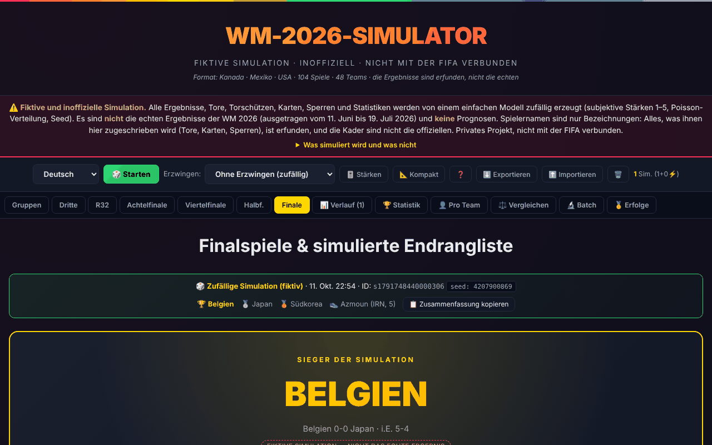

# Simulator zur Weltmeisterschaft 2026 (inoffiziell)

[English](README.md) · [Română](README.ro.md) · [Français](README.fr.md) · [Italiano](README.it.md) · [Español](README.es.md) · [Português](README.pt.md) · **Deutsch** · [Magyar](README.hu.md)

**Version:** 7.6.1 · **Zuletzt aktualisiert:** 2026-10-22

Oberflächensprachen: **Română, English, Français, Italiano, Español, Português (PT), Deutsch, Magyar**

Fiktiver Simulator der Weltmeisterschaft 2026 (48 Mannschaften, 104 Spiele) in einer einzigen HTML-Datei, ohne Server und ohne Konto. **Er ist nicht mit der FIFA verbunden, enthält keine echten Ergebnisse und ist keine Prognose.**

**Online-Anwendung:** https://chiuta.github.io/Cupa-Mondiala-2026/

## Was es ist

Ein Simulationsspiel/-experiment: Die Anwendung erzeugt zufällig ein komplettes Turnier (Gruppen, Gruppendritte, Sechzehntelfinale, Achtelfinale, Viertelfinale, Halbfinale, Spiel um Platz drei und Finale), mit Ergebnissen, Torschützen mit Minute, Karten, Sperren und Spielstatistiken. Das Format (12 Gruppen zu 4, die ersten zwei plus die besten 8 Gruppendritten, 32 Mannschaften in der K.-o.-Phase) und die Gruppen folgen dem echten Turnier vom 11. Juni bis 19. Juli 2026; **die Ergebnisse werden von einem einfachen Modell erfunden** (subjektive Stärken von 1–5 für jede Mannschaft, Tore nach der Poisson-Verteilung, Seed). Das echte Turnier ist zu Ende; nichts in der Anwendung spiegelt wider, was tatsächlich auf dem Platz geschah.

## Funktionen

In Code und Browser geprüft (Chromium headless):
- Komplette Simulation mit einem Klick (Schaltfläche „Starten“ oder Taste R), mit angezeigtem Seed; „Replay“ aus dem Verlauf wiederholt dieselbe Simulation (gleicher Seed und gleiche Stärken).
- „Erzwingen“: Sie wählen eine Mannschaft, die das simulierte Turnier zwingend gewinnt (sie erhält einen Stärkebonus, und ihre K.-o.-Ergebnisse werden arrangiert). Es ist ein „Was wäre wenn“-Szenario ohne statistischen Wert.
- Zusammenfassung der aktuellen Simulation (Sieger, Finalist, Platz drei, Torschützenkönig) im Banner von „Gruppen“ und „Finals“, mit der Schaltfläche „📋 Zusammenfassung kopieren“: Sie kopiert einen einfachen Text, der angibt, dass die Simulation fiktiv ist (die Adresse der Seite wird nur hinzugefügt, wenn die Seite über http/https ausgeliefert wird).
- Gruppen mit Tabellen und Tiebreakern (Punkte, direkter Vergleich, Tordifferenz, Tore, Fairplay aus den simulierten Karten, dann Losentscheid mit dem Seed), Rangliste der Gruppendritten, K.-o.-Baum mit der offiziellen Spielnummerierung (M73–M104) und SVG-Diagramm.
- Zuordnung der Gruppendritten im Sechzehntelfinale nach der Tabelle mit 495 Kombinationen (Anhang C des Reglements), aus öffentlichen Quellen übernommen (siehe „Grenzen“).
- Torschützen mit Minute (einschließlich Verlängerung, Elfmeter, Freistoß, Eigentor), gelbe/rote Karten, Sperren (2 Gelbe = 1 Spiel; Rot = 1 Spiel; Gelbe werden nach der Gruppenphase und nach dem Viertelfinale gelöscht), Torschützenliste.
- Bei K.-o.-Spielen angezeigte Wahrscheinlichkeiten: berechnet aus demselben Poisson-Modell, das die Simulation verwendet (keine Prognosen).
- Verlauf (höchstens 50 Simulationen, im Browser) mit Filterung, Etiketten, Vergleich von 2–4 Simulationen, aggregierten Statistiken, Statistiken pro Mannschaft und im direkten Vergleich, Statistiken pro Stadion.
- Batch: 50 / 200 / 500 / 1000 Simulationen; zeigt die Häufigkeiten des Modells (keine echten Turnierwahrscheinlichkeiten).
- Stärken-Editor (1–5 für jede Mannschaft) mit Voreinstellungen und eigenen, lokal gespeicherten Voreinstellungen.
- JSON-Export / -Import des Verlaufs; Teilen-Link `#s=…` (die Simulation komprimiert in der Adresse).
- Spielzeiten in ET und in rumänischer Zeit (ET + 7 Stunden), kompakter Modus, Erfolge, Drucken, Tastenkürzel (im Leitfaden abschaltbar).

## Verwendung

1. Öffnen Sie die Seite; beim ersten Laden wird automatisch eine Simulation erzeugt.
2. Drücken Sie „🎲 Starten“ (oder R) für eine neue; wählen Sie optional zuerst eine Mannschaft unter „Erzwingen“.
3. Gehen Sie die Phasen in der Reiterleiste durch: Gruppen, Platz 3, 1/16, Achtelfinale, Viertelfinale, Halbfinale, Finals.
4. Im „Verlauf“ können Sie Simulationen ansehen, wiederholen (Replay), etikettieren, teilen (🔗 Share), vergleichen oder löschen.
5. Wählen Sie in „Batch“ die Anzahl der Simulationen und lesen Sie die Häufigkeiten der Ergebnisse ab.
6. „🎚️ Strengths“ öffnet den Stärken-Editor; Änderungen wirken sich auf künftige Simulationen aus.
7. „⬇️ Export“ speichert den Verlauf in einer JSON-Datei; „⬆️ Import“ lädt ihn wieder.
8. Die Taste „?“ öffnet den Leitfaden mit den Tastenkürzeln; Esc schließt die Fenster.

## Datenschutz und Netzwerk

- Es gibt keine Netzwerkanfragen: Ich habe im Code kein externes `fetch`, XHR, WebSocket, keine Skripte, Schriften, Bilder oder iframes gefunden. Die Seite enthält eine CSP-Richtlinie (`connect-src 'none'`, `default-src 'none'`), die sie blockiert; die einzige URL in der Datei ist der SVG-Namensraum, auf den nicht zugegriffen wird.
- Kontaktierte externe Hosts: **keine**. Es gibt weder Telemetrie noch Konto oder Cookies.
- Lokale Speicherung (`localStorage`, Schlüssel mit dem Präfix `wc2026_`): der Verlauf der Simulationen, die eigenen Stärken und Voreinstellungen, die besuchten Reiter, der kompakte Modus, die Einstellung der Tastenkürzel und einige Erfolgsmarkierungen. Ist `localStorage` blockiert (z. B. im privaten Modus), funktioniert die Anwendung, und der Verlauf bleibt nur in der Sitzung. Wird der Speicher voll, werden die ältesten Simulationen entfernt, und Sie werden benachrichtigt.
- Achtung: Auf GitHub Pages teilen sich alle Seiten `chiuta.github.io/...` denselben `localStorage` (gleicher Ursprung); die Schlüssel dieser Anwendung haben ein Präfix, aber andere Seiten derselben Domain könnten sie lesen oder ändern.
- `#s=…`-Links und importierte JSON-Dateien werden als nicht vertrauenswürdige Daten behandelt: begrenzte Größen (auch nach der Dekompression), streng validiertes JSON, aus erlaubten Werten neu aufgebaute und als Text angezeigte Felder (Schutz gegen XSS, „Zip-Bomben“ und Prototype Pollution). Ein erhaltener Link verlangt vor dem Import Ihre Bestätigung.
- Sie verlangt keine Browserberechtigungen (Kamera, Standort, Benachrichtigungen usw.). Das Teilen per Link nutzt die Zwischenablage nur auf Ihre Aktion hin.
- Die Anwendung ist keine installierbare PWA: Sie hat keinen Service Worker; offline funktioniert sie nur, wenn Sie die Datei speichern oder der Browser sie im Cache hält.

## Grenzen und Hinweise

- **Fiktive Simulation.** Ergebnisse, Tore, Karten und Statistiken sind zufällig. Es sind nicht die echten Ergebnisse des Turniers, und es sind keine Prognosen. Die Werte in „Batch“ spiegeln die gewählten subjektiven Stärken wider, keine echten Wahrscheinlichkeiten.
- **Echte Spieler.** Spielernamen werden nur als Etiketten verwendet; die ihnen zugeschriebenen Tore, Karten und Sperren sind erfunden. Die Kader in der Anwendung sind nicht die offiziellen und wurden nicht geprüft.
- **Vereinfachtes Modell.** Seit v7.4 liegt der Torschnitt des Modells bei ≈2,7 pro Spiel (gemessen an 300 Simulationen: 2,69, einschließlich Verlängerung; bei den jüngsten Weltmeisterschaften ≈2,6–2,8); zuvor lag er bei ≈3,7. Alte Simulationen bleiben in der Anwendung markiert, und „Replay“ reproduziert sie exakt mit ihrem Modell. Es gibt keine Verletzungen, keine Form und keine echten Kader; Elfmeter, Freistöße, Eigentore und Verlängerungen haben feste Prozentsätze.
- **Spielplan.** Die Gruppen entsprechen der echten Auslosung (auf der Wikipedia-Seite des Turniers geprüft). Daten, Stadien und Zeiten (ET) stammen aus öffentlichen Kalendern Dritter (einer für die Gruppen, ein anderer für das Sechzehntelfinale, ein weiterer für Achtelfinale bis Finale); die Zeiten ab dem Achtelfinale stammen aus der Anfangsversion der Anwendung und wurden nicht unabhängig bestätigt. Fehler sind möglich.
- **Gruppendritte (Anhang C).** Die Tabelle mit 495 Kombinationen wurde von Wikipedia übernommen (einschließlich einer Spiegelung) und automatisch validiert: Vollständigkeit, zulässige Gruppen für jedes Spiel, Übereinstimmung mit dem dokumentierten realen Fall (Zeile 67). Sie wurde nicht Zeile für Zeile mit dem offiziellen FIFA-PDF verglichen.
- **Tiebreaker.** Bei völligem Gleichstand wird mit dem Seed der Simulation gelost; die FIFA-Weltrangliste wird nicht verwendet.
- **Seed.** Der Generator mulberry32 hat einen 32-Bit-Seed: reproduzierbar, aber nicht kryptografisch. Ein identisches Replay setzt dieselbe Engine voraus; mit früheren Versionen erzeugte Simulationen (in der Anwendung markiert) verwendeten einen angenäherten K.-o.-Baum und lassen sich nicht exakt reproduzieren.
- Nicht mit der FIFA verbunden; „FIFA“, „World Cup“ und die Namen von Mannschaften, Stadien und Spielern gehören ihren Inhabern und werden nur beschreibend verwendet.

## Lokal / offline ausführen

Laden Sie `index.html` herunter und öffnen Sie sie in einem Browser; sie braucht weder Server noch Internet. Teilen-Links verwenden die Adresse der geöffneten Datei (unter `file://` können sie lang und in anderen Browsern unbrauchbar sein).

## Lizenz

MIT — siehe die Datei `LICENSE`.

## Autor

Alexio — Alexandru-Ionuț Chiuță, Kontakt: alexio@trom.tf

## Zusammenfassung

Ein inoffizieller, fiktiver Simulator des Formats der FIFA-Weltmeisterschaft 2026 (48 Mannschaften, 104 Spiele) in einer Offline-HTML-Datei. Alle Ergebnisse, Torschützen, Karten und Statistiken sind zufällige Ausgaben eines einfachen Poisson-Modells mit subjektiven Mannschaftsstärken; es sind keine echten Ergebnisse oder Prognosen, und Spielernamen sind bloße Etiketten. Umgesetzt sind die Gruppen-Tiebreaker, der offizielle K.-o.-Baum und die Zuordnung der Gruppendritten (Tabelle aus Anhang C, aus öffentlichen Quellen übernommen); Importe und geteilte Links werden streng validiert. Keine Netzwerkanfragen, keine Telemetrie; die Daten bleiben in localStorage. Nicht mit der FIFA verbunden.

## Verlauf / Changelog

### 7.6.1 — 2026-10-22
- Barrierefreiheit und Mobil: Die blockierenden Browser-Dialoge (Hinweise, Bestätigungen, Texteingaben) werden durch nicht blockierende Benachrichtigungen und übersetzte modale Dialoge (8 Sprachen) ersetzt, einschließlich der Kopier-Ausweichlösung für die Zusammenfassung und den Teilen-Link.
- Mobil: Der Text ist auf schmalen Bildschirmen mindestens 12 px groß, und die Zusammenfassung des Fiktionshinweises hat eine größere Touch-Fläche.
- Das technische Etikett listet jetzt die 8 Oberflächensprachen auf (statische Optionen in der Sprachauswahl).

### 7.5.0 — 2026-10-14
- Sicherungskopie und Datenkennzeichnung (fff-kit).

### 12. Oktober 2026 (v7.4.1)
- 7.4.1 — 2026-10-12: Version und Datum der letzten Aktualisierung werden in der Anwendung angezeigt

### 11. Oktober 2026 (v7.4)
- Das Tormodell wurde neu kalibriert: Die Poisson-Intensitäten werden mit 0,72 skaliert, von ≈3,7 auf ≈2,7 Tore/Spiel (die angezeigten Wahrscheinlichkeiten verwenden dieselbe Skalierung).
- Jede Simulation hat jetzt das Feld `gm` (Tormodell); früher erzeugte (`gm` fehlt) werden mit einem Hinweis angezeigt, und „Replay“ reproduziert sie identisch mit dem alten Modell (geprüft: gleicher Seed, gleiche Ergebnisse wie in v7.3). Export/Import behält `gm` bei.

### 11. Oktober 2026 (v7.3)
- Kopierbare Zusammenfassung der Simulation (Sieger, Finalist, Platz drei, Torschützenkönig) in den Bannern „Gruppen“ und „Finals“.
- CSP: `script-src` per SHA-256-Hash, ohne `'unsafe-inline'`.

### 11. Oktober 2026 (v7.2)
- Die Warnleiste und das Bedienfeld sind jetzt Landmarks (`section` mit Namen): axe 0 Verstöße, einschließlich `region`.
- Die Liste „Erzwingen“ ist nach Gruppen (A–L) gegliedert statt als flacher Block mit 48 Einträgen; ohne das wiederholte Präfix „⚡“.
- Auf Bildschirmen ≤520 px sind Kopfzeile und Warnung kompakter, und das Bedienfeld ist eine einzige horizontal scrollbare Zeile (es nimmt viel weniger Bildschirmfläche ein).
- Das Diagramm des K.-o.-Baums ist per Tastatur fokussierbar; Version v7.2.
