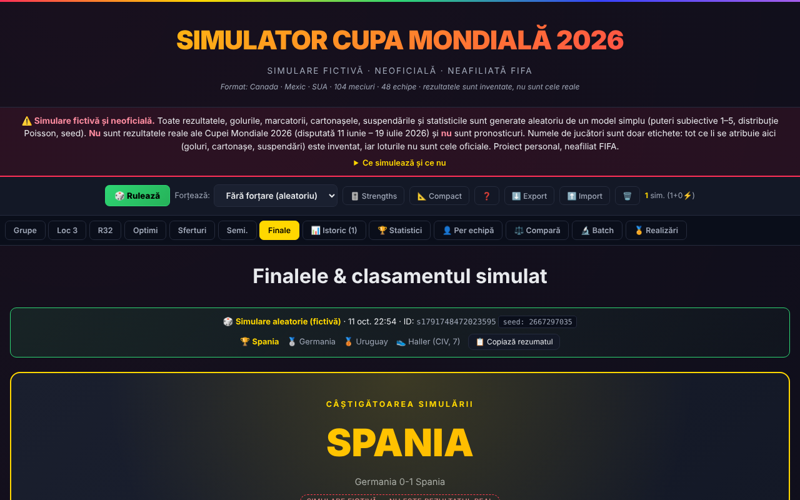

# Simulator Cupa Mondială 2026 (neoficial)

**Versiune:** 7.5.0 · **Ultima actualizare:** 14 octombrie 2026

Simulator fictiv al Cupei Mondiale 2026 (48 de echipe, 104 meciuri) într-un singur fișier HTML, fără server și fără cont. **Nu este afiliat FIFA, nu conține rezultate reale și nu este un pronostic.**

**Live:** https://chiuta.github.io/Cupa-Mondiala-2026/

## Ce este

Un joc/experiment de simulare: aplicația generează aleatoriu un turneu complet (grupe, locuri 3, 1/16, optimi, sferturi, semifinale, finala mică și finala), cu scoruri, marcatori cu minut, cartonașe, suspendări și statistici de meci. Formatul (12 grupe de 4, primele două plus cele mai bune 8 locuri 3, 32 de echipe în faza eliminatorie) și grupele urmează turneul real din 11 iunie – 19 iulie 2026; **rezultatele sunt inventate de un model simplu** (puteri subiective 1–5 pentru fiecare echipă, goluri după distribuția Poisson, seed). Turneul real s-a încheiat; nimic din aplicație nu reflectă ce s-a petrecut efectiv pe teren.

## Funcții

Verificate în cod și în browser (Chromium headless):
- Simulare completă într-un click (buton „Rulează” sau tasta R), cu seed afișat; „Replay” din istoric reface aceeași simulare (același seed și aceleași puteri).
- „Forțează”: alegi o echipă care câștigă obligatoriu turneul simulat (primește un bonus de putere, iar rezultatele eliminatorii îi sunt aranjate). Este un scenariu „ce-ar fi dacă”, fără valoare statistică.
- Rezumat al simulării curente (campioană, finalistă, locul 3, golgheter) în bannerul din „Grupe” și „Finale”, cu butonul „📋 Copiază rezumatul”: copiază un text simplu care precizează că simularea este fictivă (adresa paginii se adaugă doar când pagina e servită prin http/https).
- Grupe cu clasamente și departajare (puncte, meciuri directe, golaveraj, goluri, fair-play din cartonașele simulate, apoi tragere la sorți cu seed), clasamentul locurilor 3, tablou eliminatoriu cu numerotarea oficială a meciurilor (M73–M104) și diagramă SVG.
- Alocarea locurilor 3 în 1/16 după tabelul cu 495 de combinații (Anexa C a regulamentului), transcris din surse publice (vezi „Limite”).
- Marcatori cu minut (inclusiv prelungiri, penalty, lovitură liberă, autogol), cartonașe galbene/roșii, suspendări (2 galbene = 1 meci; roșu = 1 meci; galbenele se șterg după grupe și după sferturi), clasament golgheteri.
- Probabilități afișate la meciurile eliminatorii: calculate din același model Poisson folosit de simulare (nu sunt pronosticuri).
- Istoric (maxim 50 de simulări, în browser) cu filtrare, etichete, comparare 2–4 simulări, statistici agregate, statistici per echipă și cap-în-cap, statistici pe stadioane.
- Batch: 50 / 200 / 500 / 1000 simulări; arată frecvențele modelului (nu probabilități reale ale turneului).
- Editor de puteri (1–5 pentru fiecare echipă) cu preseturi și preseturi proprii salvate local.
- Export / import JSON al istoricului; link de partajare `#s=…` (simularea comprimată în adresă).
- Ore de meci în ET și în ora României (ET + 7 ore), mod compact, realizări, tipărire, scurtături de tastatură (se pot dezactiva din ghid).

## Manual de utilizare

1. Deschide pagina; la prima încărcare se generează automat o simulare.
2. Apasă „🎲 Rulează” (sau R) pentru una nouă; opțional alege mai întâi o echipă la „Forțează”.
3. Parcurge fazele din bara de file: Grupe, Loc 3, R32, Optimi, Sferturi, Semi., Finale.
4. În „Istoric” poți vedea, reface (Replay), eticheta, partaja (🔗 Share), compara sau șterge simulările.
5. În „Batch” alege numărul de simulări și citește frecvențele rezultatelor.
6. „🎚️ Strengths” deschide editorul de puteri; modificările afectează simulările viitoare.
7. „⬇️ Export” salvează istoricul într-un fișier JSON; „⬆️ Import” îl reîncarcă.
8. Tasta „?” deschide ghidul cu scurtăturile; Esc închide ferestrele.

## Confidențialitate și rețea

- Nu există cereri de rețea: nu am găsit `fetch`, XHR, WebSocket, scripturi, fonturi, imagini sau iframe-uri externe în cod. Pagina conține o politică CSP (`connect-src 'none'`, `default-src 'none'`) care le blochează; singurul URL din fișier este spațiul de nume SVG, care nu este accesat.
- Gazde externe contactate: **niciuna**. Nu există telemetrie, cont sau cookie-uri.
- Stocare locală (`localStorage`, chei cu prefixul `wc2026_`): istoricul simulărilor, puterile personalizate și presetările, taburile vizitate, modul compact, setarea scurtăturilor și câteva marcaje pentru realizări. Dacă `localStorage` este blocat (de exemplu mod privat), aplicația funcționează, iar istoricul rămâne doar în sesiune. Dacă spațiul se umple, cele mai vechi simulări sunt eliminate și ești anunțat.
- Atenție: pe GitHub Pages toate paginile `chiuta.github.io/...` împart același `localStorage` (aceeași origine); cheile acestei aplicații sunt prefixate, dar alte pagini de pe același domeniu le-ar putea citi sau modifica.
- Link-urile `#s=…` și fișierele JSON importate sunt tratate ca date nesigure: dimensiuni limitate (inclusiv după decompresie), JSON validat strict, câmpuri reconstruite din valori permise și afișate ca text (protecție împotriva XSS, a „zip bomb” și a poluării prototipului). Un link primit îți cere confirmarea înainte de import.
- Nu cere permisiuni ale browserului (cameră, locație, notificări etc.). Partajarea prin link folosește clipboardul doar la acțiunea ta.
- Aplicația nu este PWA instalabilă: nu are service worker; funcționează offline doar dacă salvezi fișierul sau browserul îl ține în cache.

## Limite și avertismente

- **Simulare fictivă.** Scorurile, golurile, cartonașele și statisticile sunt aleatorii. Nu sunt rezultatele reale ale turneului și nu sunt pronosticuri. Valorile din „Batch” reflectă puterile subiective alese, nu probabilități reale.
- **Jucători reali.** Numele de jucători sunt folosite doar ca etichete; golurile, cartonașele și suspendările atribuite lor sunt inventate. Loturile din aplicație nu sunt cele oficiale și nu au fost verificate.
- **Model simplificat.** De la v7.4 media de goluri a modelului este ≈2,7 pe meci (măsurată pe 300 de simulări: 2,69, inclusiv prelungirile; în turneele mondiale recente ≈2,6–2,8); înainte era ≈3,7. Simulările vechi rămân marcate în aplicație și „Replay” le reproduce exact cu modelul lor. Nu există accidentări, formă sau loturi reale; penalty-urile, loviturile libere, autogolurile și prelungirile au procente fixe.
- **Calendar.** Grupele corespund tragerii la sorți reale (verificate pe pagina Wikipedia a turneului). Datele, stadioanele și orele (ET) provin din calendare publice terțe (unul singur pentru grupe, altul pentru 1/16, altul pentru optimi–finală); orele de la optimi încolo sunt cele din versiunea inițială a aplicației și nu au fost confirmate independent. Pot exista erori.
- **Locuri 3 (Anexa C).** Tabelul de 495 de combinații a fost transcris din Wikipedia (inclusiv o oglindă a ei) și validat automat: completitudine, grupele eligibile pentru fiecare meci, concordanță cu cazul real documentat (rândul 67). Nu a fost comparat rând cu rând cu PDF-ul oficial FIFA.
- **Departajare.** Pentru egalitate totală se trage la sorți cu seed-ul simulării; clasamentul FIFA nu este folosit.
- **Seed.** Generatorul mulberry32 are seed pe 32 de biți: reproductibil, dar nu criptografic. Replay-ul identic presupune același motor; simulările create cu versiuni anterioare (marcate în aplicație) au folosit un tablou eliminatoriu aproximat și nu se reproduc exact.
- Neafiliat FIFA; „FIFA”, „World Cup” și numele echipelor, stadioanelor și jucătorilor aparțin proprietarilor lor și sunt folosite doar descriptiv.

## Rulare locală / offline

Descarcă `index.html` și deschide-l în browser; nu are nevoie de server sau de internet. Link-urile de partajare folosesc adresa fișierului deschis (pe `file://` pot fi lungi și neutilizabile în alte browsere).

## Licență

MIT — vezi fișierul `LICENSE`.

## Autor

Alexio — Alexandru-Ionuț Chiuță, contact: alexio@trom.tf

## English summary

An unofficial, fictional simulator of the 2026 FIFA World Cup format (48 teams, 104 matches) in one offline HTML file. All scores, scorers, cards and statistics are random output of a simple Poisson model with subjective team strengths; they are not real results or predictions, and player names are mere labels. Group tiebreakers, the official knockout bracket and the third-place allocation (Annex C table, transcribed from public sources) are implemented; imports and shared links are strictly validated. No network requests, no telemetry; data stays in localStorage. Not affiliated with FIFA.

## Istoric / Changelog

### 7.5.0 — 2026-10-14
- Copie de rezervă și etichetare date (fff-kit).

### 12 octombrie 2026 (v7.4.1)
- 7.4.1 — 2026-10-12: versiunea și data ultimei actualizări sunt afișate în aplicație

### 11 octombrie 2026 (v7.4)
- Modelul de goluri a fost recalibrat: intensitățile Poisson sunt scalate cu 0,72, de la ≈3,7 la ≈2,7 goluri/meci (probabilitățile afișate folosesc aceeași scalare).
- Fiecare simulare are acum câmpul `gm` (model de goluri); cele create înainte (`gm` lipsă) se afișează cu o notă și „Replay” le reproduce identic cu modelul vechi (verificat: același seed, aceleași scoruri ca în v7.3). Exportul/importul păstrează `gm`.

### 11 octombrie 2026 (v7.3)
- Rezumat copiabil al simulării (campioană, finalistă, locul 3, golgheter) în bannerele „Grupe” și „Finale”.
- CSP: `script-src` pe hash SHA-256, fără `'unsafe-inline'`.

### 11 octombrie 2026 (v7.2)
- Bara de avertisment și panoul de comenzi sunt acum repere (`section` cu nume): axe 0 încălcări, inclusiv `region`.
- Lista „Forțează” este grupată pe grupe (A–L) în loc de un bloc plat de 48 de intrări; fără prefixul „⚡” repetat.
- Pe ecrane ≤520 px antetul și avertismentul sunt mai compacte, iar panoul de comenzi este un singur rând derulabil orizontal (ocupă mult mai puțin din ecran).
- Diagrama tabloului eliminatoriu este focalizabilă de la tastatură; versiune v7.2.
